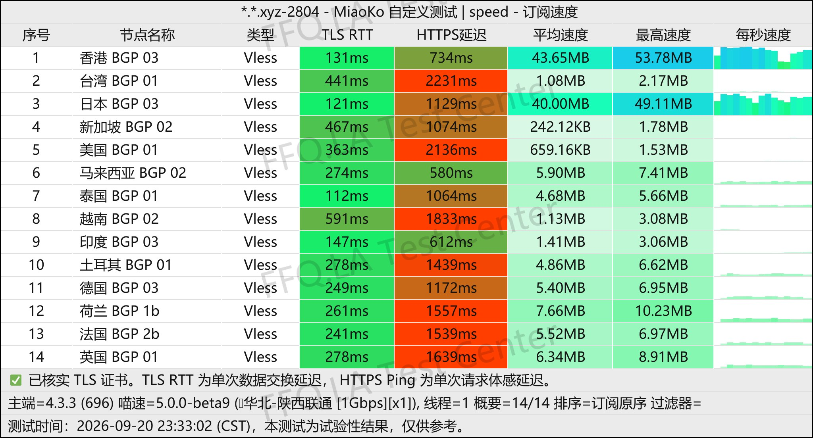
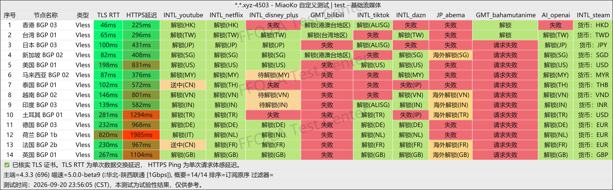
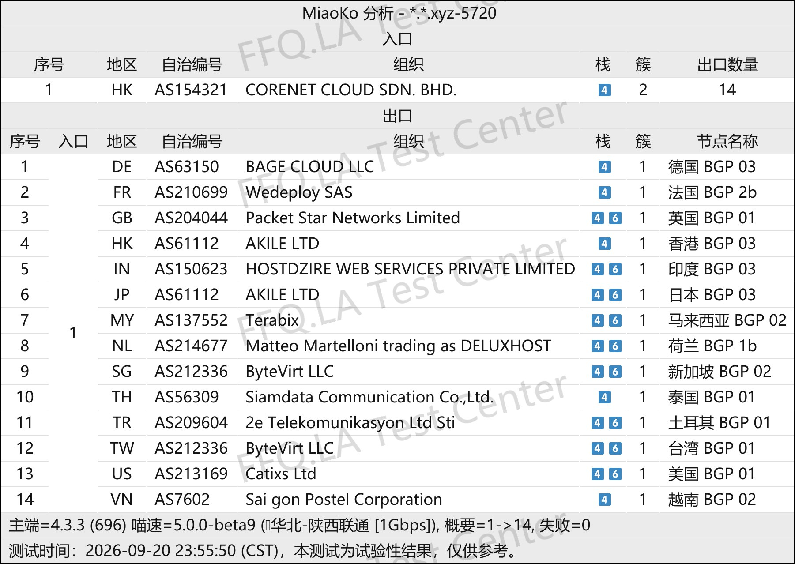

🇨🇳 [中文](README.md) | 🇺🇸 English | 🇷🇺 [Русский](README_RU.md) | 🇮🇷 [فارسی](README_FA.md)

# Xiaoniu Smart Connect VPN Official Website (Updated November 12, 2026)

Official Xiaoniu Smart Connect VPN Website<br>
Latest URL: [www.xnssr.com](https://to.iix.im/xn01)<br>
Official URL: [www.xnssr.com](https://to.iix.im/xn01)<br>

Best VPN Recommendations and Server List for 2026: [https://github.com/jdnei/JiChangTuiJian](https://github.com/jdnei/JiChangTuiJian)<br>

## Telegram VPN Deals & Community #AD
[VPN Giveaways](https://331024.de/archives/choujiang) | [VPN Chat Group](https://331024.de/archives/choujiang) | [VPN Trial Group](https://331024.de/archives/choujiang)<br>

[https://331024.de/archives/choujiang](https://331024.de/archives/choujiang)

## Invitation Code

`This invitation code provides a 3-day trial plan with 1 GB of data. The provider may discontinue this promotion at any time.`

```bash
vqoySz1q
```

<br>

## Promo Code / Discount Code

```bash
None
```

## Overview
Xiaoniu Smart Connect VPN is a network acceleration service designed for international internet access and global connectivity.

The service focuses on IEPL dedicated lines, BGP routing optimized for China's three major internet carriers, and servers in multiple regions.

It supports major platforms, including Windows, macOS, iOS, and Android, making it suitable for accessing international streaming services, AI tools, developer resources, and everyday global internet services.

Xiaoniu emphasizes connection stability and ease of use, providing a convenient solution for users who require reliable international network access.

## Advantages
Xiaoniu Smart Connect VPN combines `IEPL dedicated lines` with intelligent `BGP` routing to balance connection speed, latency, and stability during peak hours.

All servers use a standard 1× traffic multiplier, meaning data usage is counted at its actual rate.

The service offers flexible subscription options and supports popular VPN clients such as Clash and Shadowrocket.

It is suitable for streaming services, AI tools, and multi-platform usage. With straightforward configuration and reliable network performance, Xiaoniu is designed for long-term everyday use.

## Pricing Plans

## 📊 Performance Tests & Analysis

#### 1. Evening Peak-Hour Speed Test
<br>

#### 2. Streaming Service Unblocking Report
<br>

#### 3. Entry and Exit Node Analysis
<br>
