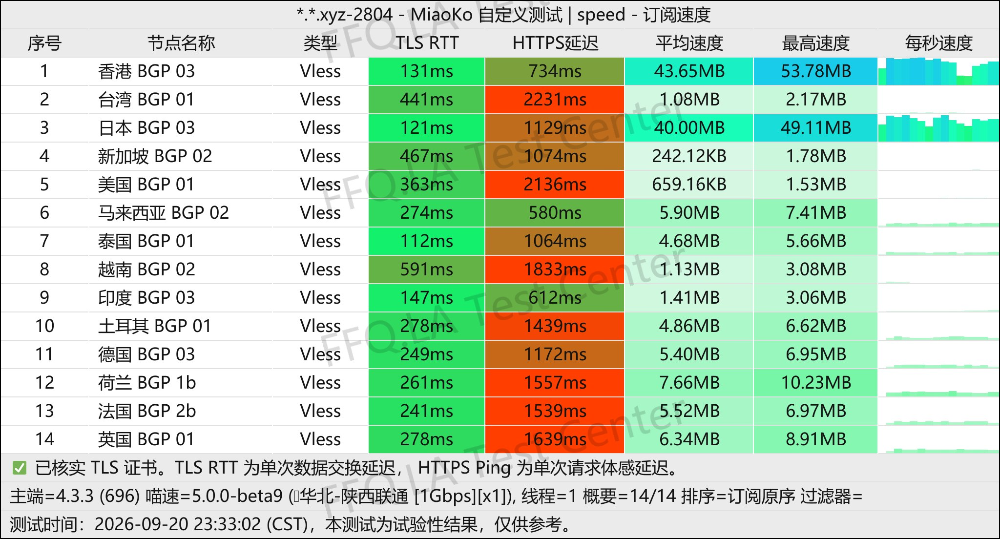
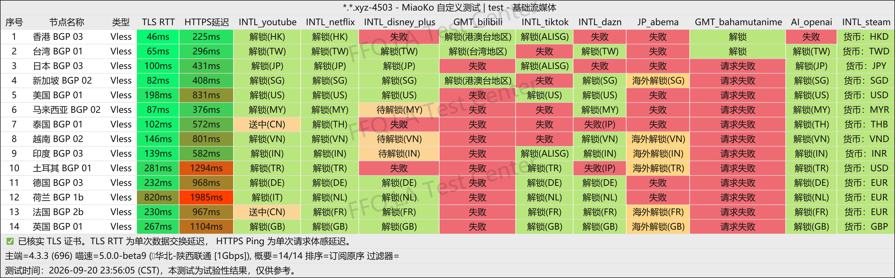
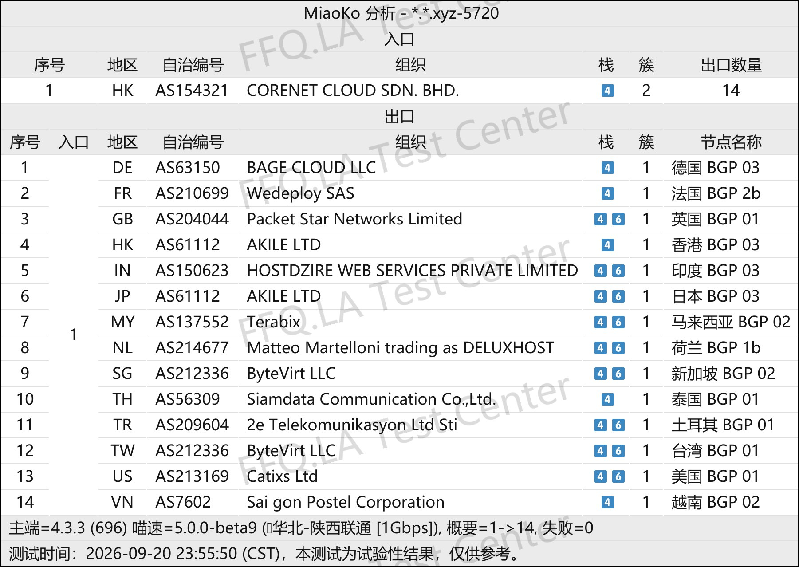

 🇨🇳 [中文](README.md) | 🇺🇸 [English](README_EN.md) | 🇷🇺 [Русский](README_RU.md) | 🇮🇷 فارسی

# وب‌سایت رسمی Xiaoniu Smart Connect VPN(به‌روزرسانی 13 نوامبر 2026)
وب‌سایت رسمی Xiaoniu Smart Connect VPN<br>
آخرین آدرس: [www.xnssr.com](https://to.iix.im/xn01)<br>
آدرس رسمی: [www.xnssr.com](https://to.iix.im/xn01)<br>

معرفی بهترین سرویس‌ها و سرورهای VPN در سال ۲۰۲۶: [https://github.com/jdnei/JiChangTuiJian](https://github.com/jdnei/JiChangTuiJian)<br>

## انجمن و پیشنهادهای ویژه VPN در تلگرام #AD
[قرعه‌کشی VPN](https://331024.de/archives/choujiang) | [گروه گفت‌وگوی VPN](https://331024.de/archives/choujiang) | [گروه آزمایش VPN](https://331024.de/archives/choujiang)<br>

[https://331024.de/archives/choujiang](https://331024.de/archives/choujiang)

## کد دعوت

`این کد دعوت یک طرح آزمایشی ۳ روزه با ۱ گیگابایت ترافیک ارائه می‌دهد. ارائه‌دهنده ممکن است این پیشنهاد را در هر زمانی لغو کند.`

```bash
vqoySz1q
```

<br>

## کد تخفیف

```bash
ندارد
```

## معرفی
Xiaoniu Smart Connect VPN یک سرویس افزایش سرعت شبکه است که برای دسترسی بین‌المللی به اینترنت و ارتباطات جهانی طراحی شده است.

این سرویس بر خطوط اختصاصی IEPL، مسیریابی BGP بهینه‌شده برای سه اپراتور اصلی اینترنت چین و ارائه سرورهایی در مناطق مختلف تمرکز دارد.

Xiaoniu از پلتفرم‌های محبوبی مانند Windows، macOS، iOS و Android پشتیبانی می‌کند و برای دسترسی به سرویس‌های پخش آنلاین بین‌المللی، ابزارهای هوش مصنوعی، منابع توسعه نرم‌افزار و استفاده روزمره از خدمات اینترنت جهانی مناسب است.

این سرویس بر پایداری اتصال و سهولت استفاده تأکید دارد و راهکاری مناسب برای کاربرانی فراهم می‌کند که به دسترسی مطمئن به شبکه‌های بین‌المللی نیاز دارند.

## مزایا
Xiaoniu Smart Connect VPN خطوط اختصاصی `IEPL` را با مسیریابی هوشمند `BGP` ترکیب می‌کند تا تعادلی میان سرعت اتصال، تأخیر شبکه و پایداری در ساعات اوج مصرف ایجاد کند.

تمام سرورها از ضریب محاسبه ترافیک استاندارد ۱× استفاده می‌کنند؛ یعنی حجم مصرفی بدون ضریب اضافی محاسبه می‌شود.

این سرویس طرح‌های اشتراک انعطاف‌پذیری ارائه می‌دهد و با کلاینت‌های محبوب VPN مانند Clash و Shadowrocket سازگار است.

Xiaoniu برای استفاده از سرویس‌های پخش آنلاین، ابزارهای هوش مصنوعی و دستگاه‌های مختلف مناسب است. با تنظیمات ساده و عملکرد پایدار شبکه، این سرویس برای استفاده روزمره و بلندمدت طراحی شده است.

## طرح‌های اشتراک

## 📊 آزمایش عملکرد و تحلیل

#### 1. آزمایش سرعت در ساعات اوج مصرف شبانه
<br>

#### 2. گزارش رفع محدودیت سرویس‌های پخش آنلاین
<br>

#### 3. تحلیل سرورهای ورودی و خروجی
<br>
