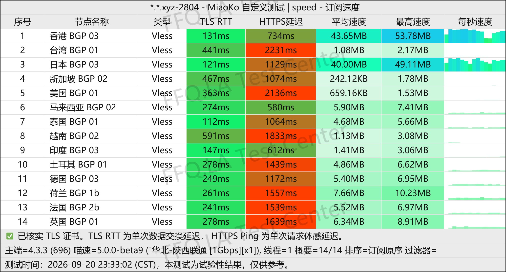
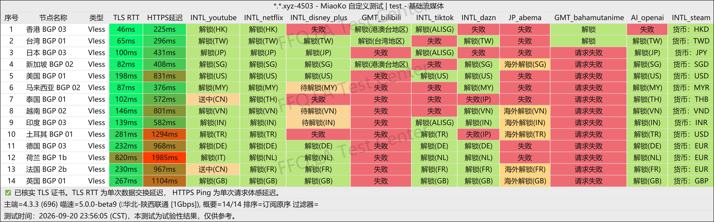
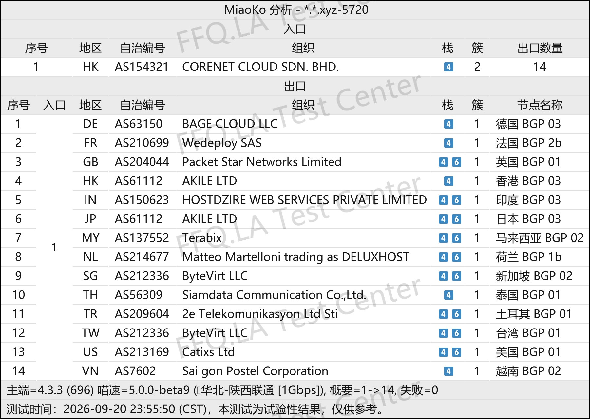

🇨🇳 [中文](README.md) | 🇺🇸 [English](README_EN.md) | 🇷🇺 Русский | 🇮🇷 [فارسی](README_FA.md)

# Официальный сайт Xiaoniu Smart Connect VPN (обновлено 3 ноября 2026)

Официальный сайт Xiaoniu Smart Connect VPN<br>
Актуальный адрес: [www.xnssr.com](https://to.iix.im/xn01)<br>
Официальный адрес: [www.xnssr.com](https://to.iix.im/xn01)<br>

Лучшие VPN-сервисы и серверы на 2026 год: [https://github.com/jdnei/JiChangTuiJian](https://github.com/jdnei/JiChangTuiJian)<br>

## Telegram: VPN-сообщество и специальные предложения #AD
[Розыгрыши VPN](https://331024.de/archives/choujiang) | [Чат о VPN](https://331024.de/archives/choujiang) | [Группа тестирования VPN](https://331024.de/archives/choujiang)<br>

[https://331024.de/archives/choujiang](https://331024.de/archives/choujiang)

## Пригласительный код

`Этот пригласительный код предоставляет пробный тариф на 3 дня с 1 ГБ трафика. Провайдер может отменить данную акцию в любое время.`

```bash
vqoySz1q
```

<br>

## Промокод / Код скидки

```bash
Нет
```

## Обзор
Xiaoniu Smart Connect VPN — сервис ускорения сетевых соединений, предназначенный для международного доступа в интернет и глобальной сетевой связи.

Сервис специализируется на выделенных линиях IEPL, маршрутизации BGP, оптимизированной для трёх крупнейших интернет-операторов Китая, и предоставлении серверов в различных регионах.

Xiaoniu поддерживает основные платформы, включая Windows, macOS, iOS и Android. Сервис подходит для доступа к международным стриминговым платформам, инструментам искусственного интеллекта, ресурсам для разработчиков и повседневного использования зарубежных интернет-сервисов.

Основное внимание уделяется стабильности соединения и простоте использования, что делает Xiaoniu удобным решением для пользователей, которым необходим надёжный международный доступ в интернет.

## Преимущества
Xiaoniu Smart Connect VPN объединяет выделенные линии `IEPL` с интеллектуальной маршрутизацией `BGP`, обеспечивая баланс между скоростью соединения, задержкой и стабильностью в часы пик.

На всех серверах применяется стандартный коэффициент учёта трафика 1×, то есть фактически использованный трафик списывается без дополнительного множителя.

Сервис предлагает гибкие тарифные планы и поддерживает популярные VPN-клиенты, включая Clash и Shadowrocket.

Xiaoniu подходит для использования стриминговых сервисов, инструментов искусственного интеллекта и различных платформ.

Благодаря простой настройке и стабильной работе сети сервис ориентирован на длительное повседневное использование.

## Тарифные планы

## 📊 Тесты производительности и анализ

#### 1. Тест скорости в вечерние часы пик
<br>

#### 2. Отчёт о разблокировке стриминговых сервисов
<br>

#### 3. Анализ входных и выходных узлов
<br>
